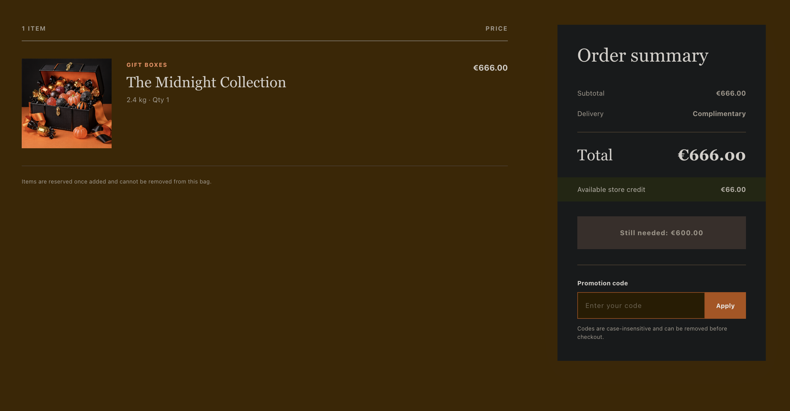
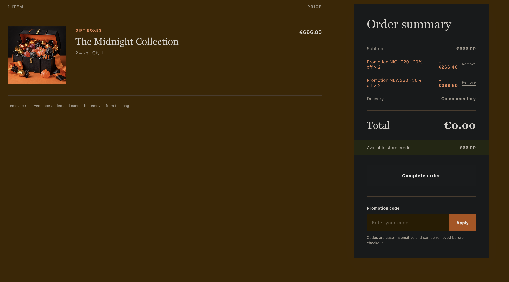
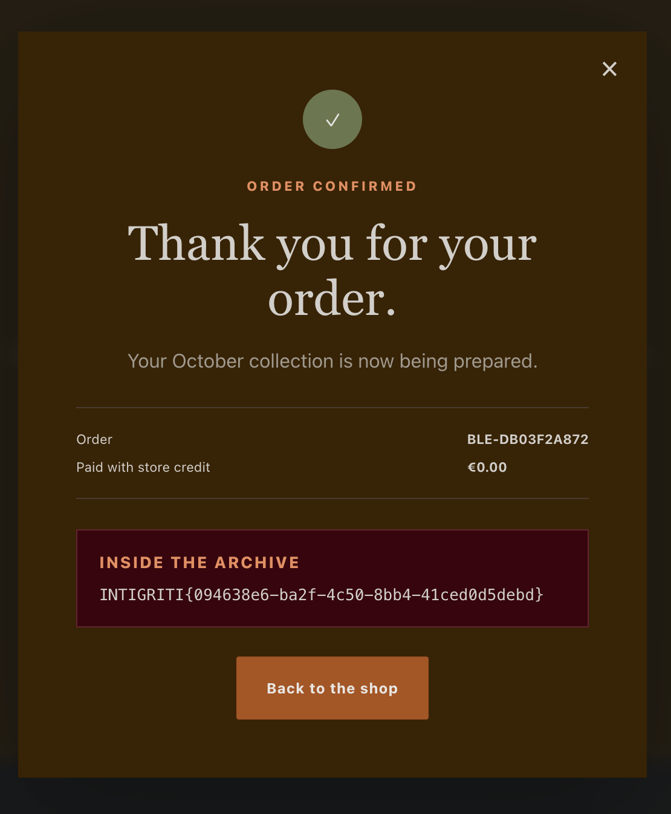

# Intigriti Challenge 1026 — Flag via Alternating Coupons

> **CTF solution.** This is a write-up of the deliberately vulnerable challenge storefront, not a production vulnerability report.

## Solve

Add one **The Midnight Collection** item (€666.00), obtain `NEWS30` from the newsletter form using a synthetic address, then apply these codes sequentially—waiting for each application to complete:

```text
NIGHT20 → NEWS30 → NIGHT20 → NEWS30
```

Each code is accepted twice when alternated. The cart reaches **€0.00** and the normal simulated checkout reveals:

```text
INTIGRITI{094638e6-ba2f-4c50-8bb4-41ced0d5debd}
```

## Evidence

**Starting state:** one €666.00 eligible item and €66.00 store credit.



**After the sequence:** `NIGHT20 × 2` discounts €266.40; `NEWS30 × 2` discounts €399.60; cart total is €0.00.



**Successful checkout:** the confirmation shows the flag and €0.00 paid with store credit.



See [WRITEUP.md](WRITEUP.md) for the full challenge context, step-by-step reproduction, arithmetic, analysis, and research boundaries.

The challenge instructions require that public write-ups wait until both the challenge has ended and new submissions are no longer accepted. The listed end time was 26 October 2026 at 23:59 UTC; confirm the live submission-closure status before publishing this repository.
