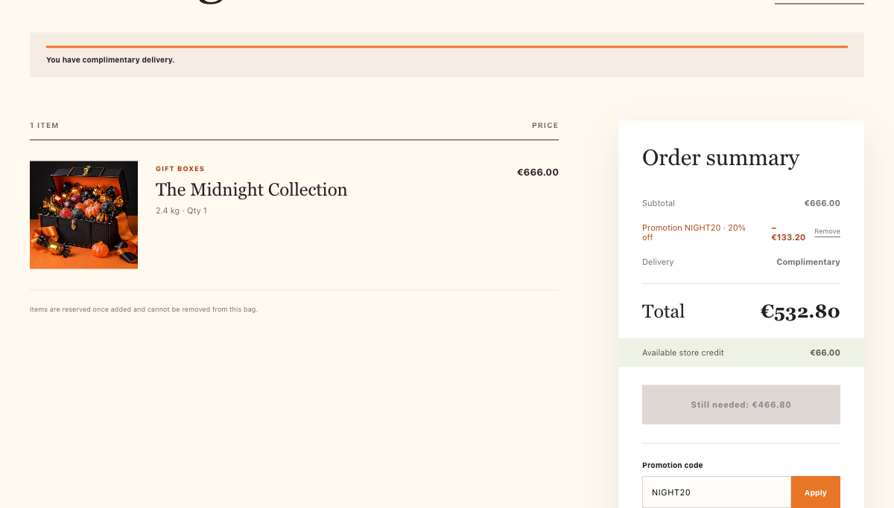
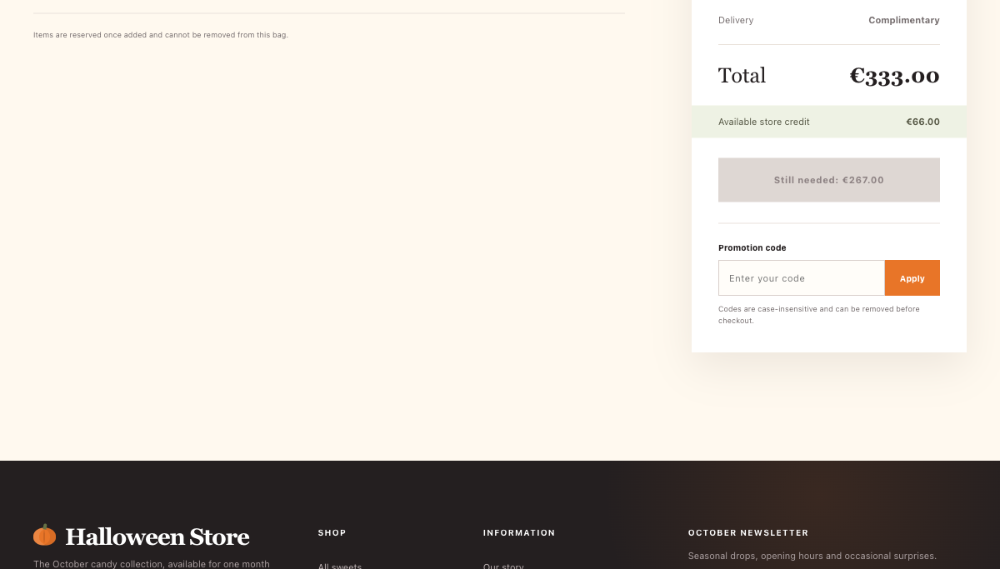

# Intigriti Challenge 1026: Following the Halloween Store's Money

## TL;DR

The challenge presented a Halloween storefront with **€66.00 of store credit** and a special product priced at **€666.00**. The apparent goal was to complete an order for that product and reach the receipt path that renders a server-supplied flag.

I investigated three plausible business-logic weaknesses:

1. applying the advertised `NIGHT20` coupon more than once;
2. bypassing the disabled checkout button by calling the API directly; and
3. combining `NIGHT20` with the newsletter-issued `NEWS30` code.

None produced a solve. The duplicate coupon was rejected with HTTP 409, the checkout endpoint independently enforced the credit limit with HTTP 402, and the two distinct promotions reduced the total only to €333.00. No receipt or flag was returned.

This is a write-up of a bounded investigation and its negative result—not a claim that every possible attack path was exhausted.

## Challenge setup

| Property | Observed value |
| --- | --- |
| Target | `https://challenge-1026.challenges.intigriti.io` |
| Application | Halloween Store |
| Session credit | `6600` cents (€66.00) |
| Target product | `midnight-vault` / The Midnight Collection |
| Product price | `66600` cents (€666.00) |
| Public promotion | `NIGHT20` (20% off) |
| Newsletter promotion | `NEWS30` (30% off) |


The special product was described as a one-off archive box. Once it was added, the cart warned that reserved items could not be removed, so the tests were deliberately kept small and sequential.

## Reconnaissance

Reviewing normal browser traffic and the served front-end JavaScript exposed a small JSON API:

| Method | Endpoint | Purpose |
| --- | --- | --- |
| `GET` | `/api/session` | Return the current store credit |
| `GET` | `/api/products` | Return the six-product catalogue |
| `GET` | `/api/cart` | Return cart totals and promotion state |
| `POST` | `/api/cart/items` | Add a product with `{ "productId": ... }` |
| `POST` | `/api/cart/coupon` | Apply a code with `{ "code": ... }` |
| `POST` | `/api/cart/coupon/remove` | Remove an applied code |
| `POST` | `/api/newsletter` | Subscribe an email and receive a welcome code |
| `POST` | `/api/checkout` | Attempt to complete the order |

Two details made the checkout flow interesting:

- the client disabled its checkout button while `state.cart.canCheckout` was false; and
- the receipt view rendered a flag only when the checkout response contained `receipt.flag`.

That suggested a classic question: was the credit restriction only a UI control, or did the API enforce it as well?

## Establishing the cart

I added the target product once:

```http
POST /api/cart/items
Content-Type: application/json

{"productId":"midnight-vault"}
```

The server returned HTTP 200 and the cart showed one item with a €666.00 subtotal.

## Test 1 — duplicate coupon stacking

### Hypothesis

The UI posted coupon codes to the server and could display a promotion count. If the API failed to enforce uniqueness, repeatedly applying the public `NIGHT20` code might stack enough 20% discounts to bring the order within the €66.00 credit.

### First application

```http
POST /api/cart/coupon
Content-Type: application/json

{"code":"NIGHT20"}
```

The first request behaved normally:

- HTTP 200;
- discount: €133.20;
- total: €532.80; and
- remaining shortfall: €466.80.



### Duplicate application

Sending the same request a second time returned:

```text
HTTP 409
error: coupon_already_applied
```

The promotion count and total did not change. The server, rather than merely the client, prevented reuse of the same code. I stopped this test after the first rejection instead of attempting further duplicates.

**Result:** hypothesis falsified.

## Test 2 — direct checkout

### Hypothesis

Because the browser disabled the checkout button based on client-side cart state, a direct request might bypass that presentation-layer restriction.

With the total still at €532.80, I sent one checkout request:

```http
POST /api/checkout
Content-Type: application/json

{}
```

The response was:

```text
HTTP 402
error: insufficient_credit
message: Your store credit does not cover this order.
```

The cart remained unchanged and the response contained neither a receipt nor a flag. The button state was only a usability control; the important authorization decision was repeated by the server.

**Result:** hypothesis falsified.

## Test 3 — newsletter promotion

### Hypothesis

The footer's newsletter form submitted an email address to `/api/newsletter` and displayed a returned `code`. That code might be unusually valuable or combine with `NIGHT20` to unlock checkout.

I submitted a single synthetic, non-deliverable address:

```http
POST /api/newsletter
Content-Type: application/json

{"email":"ctf-1026@example.invalid"}
```

The endpoint returned HTTP 200 and the welcome code `NEWS30`. Applying it once succeeded and added a 30% discount.

The application calculated both promotions from the original €666.00 subtotal:

```text
NIGHT20: 20% × €666.00 = €133.20
NEWS30:  30% × €666.00 = €199.80
                         --------
Total discount:           €333.00
Final total:              €333.00
Available credit:          €66.00
Remaining shortfall:      €267.00
```

In other words, the observed discounts combined **additively** to 50%. They were not applied sequentially; sequential 20%-then-30% discounting would have produced €372.96, which is not what the application returned.



Since the checkout condition was still not met, I did not repeat the already-falsified checkout test.

**Result:** the code was valid but insufficient; no bypass was found.

## Sanitized request/response log

| Request | Researcher-controlled body | Observed result |
| --- | --- | --- |
| `POST /api/cart/items` | `{"productId":"midnight-vault"}` | 200; one archive item added |
| `POST /api/cart/coupon` | `{"code":"NIGHT20"}` | 200; 20% applied; total `53280` cents |
| `POST /api/cart/coupon` | `{"code":"NIGHT20"}` | 409 `coupon_already_applied`; no change |
| `POST /api/checkout` | `{}` | 402 `insufficient_credit`; no receipt or flag |
| `POST /api/newsletter` | `{"email":"ctf-1026@example.invalid"}` | 200; returned `NEWS30` |
| `POST /api/cart/coupon` | `{"code":"NEWS30"}` | 200; total `33300` cents |

Cookies, authorization headers, and unrelated response data are intentionally omitted.

## What the evidence establishes

The captured behavior supports three narrow conclusions:

- a single coupon cannot be reapplied in the same cart;
- the server independently enforces the available-credit rule at checkout; and
- the two discovered, distinct coupons can coexist, but their combined discount is not enough to purchase the target item.

It does **not** establish that the application had no vulnerability anywhere. The tests were intentionally bounded, no coupon values were enumerated, and no successful checkout was achieved.

## Takeaways

Even without a flag, the exercise highlights several useful business-logic testing habits:

1. **Translate the goal into arithmetic.** The required reduction was €600.00—about 90.09% of the original price. That immediately shows why ordinary 20% and 30% offers are insufficient.
2. **Separate UI controls from server controls.** A disabled button is worth testing, but the API's HTTP 402 response showed that the decisive rule also existed server-side.
3. **Determine how discounts compose.** Additive and sequential percentage discounts produce different totals. Recording the server's actual arithmetic prevents a misleading explanation.
4. **Stop when a hypothesis is falsified.** One duplicate rejection and one direct checkout response were enough to answer their respective questions without noisy retries.
5. **Report negative results honestly.** A useful write-up should say exactly what the evidence proves and avoid turning an incomplete investigation into a fictional solve.

## Conclusion

The observed coupon and checkout paths held up against the three tested business-logic hypotheses. `NIGHT20` could not be duplicated, `/api/checkout` rejected an underfunded order on the server, and `NEWS30` lowered the total only to €333.00—still €267.00 above the available credit.

No successful checkout, receipt, or `INTIGRITI{...}` flag was obtained during this session. The value of this investigation lies in its reproducible evidence and clear boundary between what was tested and what remains unknown.

