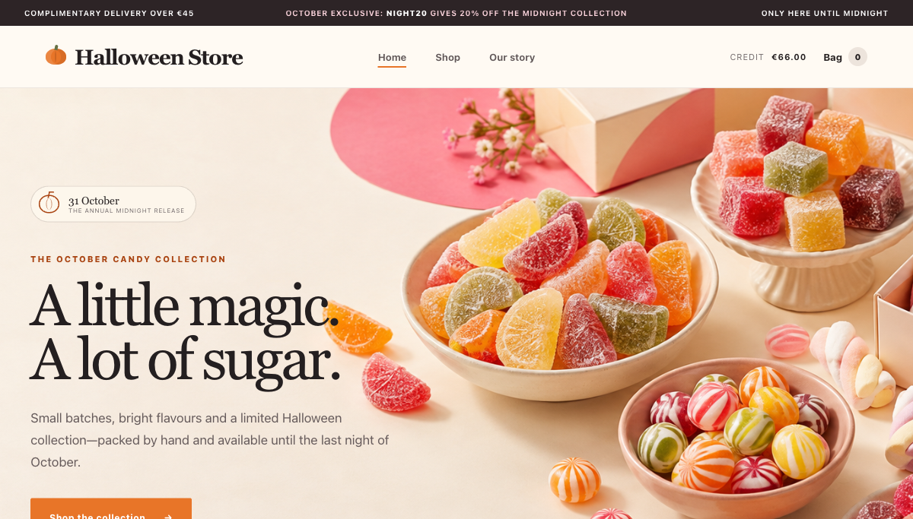

# Intigriti Challenge 1026 — Alternating Promotion Codes to Reveal the Flag

> **CTF solution write-up:** This demonstrates the intended challenge path on Intigriti’s isolated Challenge 1026 storefront. It is not a claim of a vulnerability in a production merchant.

## The solve in one line

Add one **The Midnight Collection** item (€666.00), reveal `NEWS30` through the newsletter form, and apply the codes in this exact order:

```text
NIGHT20 → NEWS30 → NIGHT20 → NEWS30
```

The cart accepts each code twice when they are alternated. The combined discounts reach €666.00, the cart total becomes **€0.00**, and completing the simulated checkout returns the challenge flag.

## Challenge and scope

Challenge 1026 (“Come play our monthly CTF!”) is a deliberately vulnerable Halloween Store. The challenge rules require a flag in the format `INTIGRITI{.*}`, the payloads used, and short solve steps; self-XSS and man-in-the-middle solutions are excluded. Testing here was limited to the challenge host:

`https://challenge-1026.challenges.intigriti.io`

The storefront initially displayed **€66.00** of store credit and advertised `NIGHT20` as 20% off the Midnight Collection.



## Reproduction steps

1. Open the challenge storefront in a fresh session.
2. Add one **The Midnight Collection** (`midnight-vault`) item to the bag. Its price is €666.00.
3. Use the newsletter form with a synthetic address such as `ctf-1026@example.invalid`. The challenge returns the code `NEWS30`; no personal email is needed.
4. In the cart, apply one code at a time in this exact sequence. Wait for each application to finish before entering the next:

   ```text
   NIGHT20
   NEWS30
   NIGHT20
   NEWS30
   ```

5. After the fourth application, verify the cart shows `NIGHT20 × 2`, `NEWS30 × 2`, and a **€0.00** total.
6. Click **Complete order** once. The simulated order confirmation displays the flag.

## Evidence and state changes

### 1. Start with the eligible item

The initial cart contains one Midnight Collection item at €666.00. The available store credit is €66.00, so the checkout is not yet eligible.


### 2. Alternate the two codes

The significant behavior is the **order** of applications: the same code is not submitted consecutively. Instead, alternate the codes as `NIGHT20 → NEWS30 → NIGHT20 → NEWS30`. After the sequence, the cart records two applications of each promotion:

- `NIGHT20` (20%) × 2 = **€266.40** discount
- `NEWS30` (30%) × 2 = **€399.60** discount
- Total discount = **€666.00**
- Remaining cart total = **€0.00**


### 3. Complete the simulated checkout and capture the flag

With the total at zero, the storefront enables **Complete order**. The normal challenge checkout succeeds, shows €0.00 paid with store credit, and reveals:

```text
INTIGRITI{094638e6-ba2f-4c50-8bb4-41ced0d5debd}
```


## Why this works

The observed application rejects a repeated code when it is applied immediately again, but accepts it after a different promotion is applied. Alternating the two known codes therefore bypasses the apparent duplicate-use restriction and lets their discounts accumulate until the full item price is covered.

The behavior is consistent with duplicate checking that considers only the most recently applied promotion instead of the complete set of promotions already on the cart. That is an inference from the reproducible application behavior; the available evidence does not establish the exact backend implementation.

## Impact in the CTF

The sequence bypasses the challenge store’s apparent one-use-per-code rule, discounts the eligible item by 100%, and reaches the challenge’s flag-bearing checkout confirmation. This is proof of the intended CTF solution only; it does not demonstrate impact on a real-world store.

## Defensive takeaway

In a production commerce system, enforce coupon eligibility against canonical server-side cart state and the full set of promotions already applied. Make validation and application atomic, recalculate discounts at checkout, and enforce a product/order-specific maximum discount so the final payable total cannot fall below the intended minimum.

## Research boundaries

- One challenge item and the two codes exposed by the challenge flow were used.
- `NEWS30` was obtained with a synthetic `.invalid` address.
- Testing was performed in Chrome Incognito on the in-scope challenge host.
- No real payment, personal email, signed-in browser profile, off-scope host, or other participant’s data was involved.
- The checkout was the challenge’s simulated flow.

## Publication timing

The challenge page says to wait until the challenge has ended **and no new submissions are accepted** before making a write-up public. The posted end time was 26 October 2026 at 23:59 UTC. Check the live program page for the submission-closure condition before publishing this repository.
